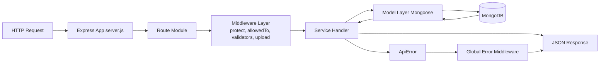

# Node.js E-Commerce API (v1)


A modular REST API for e-commerce use cases, built with Node.js, Express, and MongoDB.
The current scope includes authentication, role-based access control, catalog management, reviews, wishlist, addresses, coupons, cart, orders, payment workflows, image processing, validation, and reusable query utilities.

## Table of Contents

- [Overview](#overview)
- [Feature Set](#feature-set)
- [Tech Stack](#tech-stack)
- [Architecture](#architecture)
- [Project Structure](#project-structure)
- [Request Flow Diagram](#request-flow-diagram)
- [Request Lifecycle](#request-lifecycle)
- [API Modules](#api-modules)
- [Sample API Calls](#sample-api-calls)
- [Authentication and Security](#authentication-and-security)
- [Validation and Error Handling](#validation-and-error-handling)
- [Database Design](#database-design)
- [Project Status](#project-status)
- [Roadmap](#roadmap)
- [Installation](#installation)
- [Environment Variables](#environment-variables)
- [Run the Project](#run-the-project)
- [License](#license)

## Overview

This project follows a layered backend architecture:

- route modules define endpoint contracts,
- service modules implement business logic,
- Mongoose models encapsulate data access and schema behavior,
- shared middleware/utilities standardize validation, errors, and query behavior.

## Feature Set

### Authentication and Authorization

- JWT-based signup and login.
- Route protection using Bearer tokens.
- Role-based authorization (`user`, `manager`, `admin`).
- Password reset workflow with email OTP verification.
- Token invalidation after password changes.

### User Management

- Admin/manager user listing and retrieval.
- Admin create, update, delete, and password-change operations.
- Logged-in user profile operations (read, update, password update, deactivation).
- Optional profile image upload and processing.

### Catalog and Content

- Products: full CRUD with image cover and gallery uploads.
- Categories: full CRUD.
- Subcategories: full CRUD with category nested routes.
- Brands: full CRUD with image upload.
- Reviews: full CRUD with ownership checks and one-review-per-user-per-product enforcement.

### Customer Features

- Wishlist: add, remove, and list products for logged-in users.
- Addresses: add, remove, and list saved addresses.

### API Utilities and Platform Concerns

- Filtering, keyword search, sorting, field limiting, and pagination.
- Centralized error handling with environment-aware responses.
- Request validation with `express-validator`.
- Image handling with Multer (memory storage) and Sharp.
- Rating aggregation updates on review create/delete.

## Tech Stack

### Backend Core

- Node.js
- Express.js (v5)
- MongoDB
- Mongoose

### Main Packages

| Purpose         | Package                               |
| --------------- | ------------------------------------- |
| Auth            | `jsonwebtoken`, `bcryptjs`            |
| Validation      | `express-validator`                   |
| Async handlers  | `express-async-handler`               |
| Upload/Images   | `multer`, `sharp`                     |
| Email           | `nodemailer`                          |
| Query/Utilities | `slugify`, `uuid`, `dotenv`, `morgan` |

Recommended additional badges for GitHub (optional):

- npm version
- CI status (once workflows are added)
- last commit
- code style (ESLint/Prettier)

## Architecture

- Pattern: Layered architecture with feature-oriented modules.
- Reuse strategy: Generic CRUD handlers via `services/handlersFactory.js`.
- Data behavior: Model hooks, populate, virtuals, and aggregation are handled at the model layer.
- API consistency: Shared middleware for validation, upload filtering, and error formatting.

## Project Structure

```text
.
|-- config/
|   `-- database.js
|-- middlewares/
|   |-- errorMiddleware.js
|   |-- uploadImageMiddleware.js
|   `-- validatorMiddleware.js
|-- models/
|   |-- brandModel.js
|   |-- cartModel.js
|   |-- categoryModel.js
|   |-- couponModel.js
|   |-- orderModel.js
|   |-- productModel.js
|   |-- reviewModel.js
|   |-- subCategoryModel.js
|   `-- userModel.js
|-- routes/
|   |-- addressRoute.js
|   |-- authRoute.js
|   |-- brandRoute.js
|   |-- cartRoute.js
|   |-- categoryRoute.js
|   |-- couponRoute.js
|   |-- orderRoute.js
|   |-- productRoute.js
|   |-- reviewRoute.js
|   |-- subCategoryRoute.js
|   |-- userRoute.js
|   `-- wishlistRoute.js
|-- services/
|   |-- addressService.js
|   |-- authService.js
|   |-- brandService.js
|   |-- cartService.js
|   |-- categoryService.js
|   |-- couponService.js
|   |-- handlersFactory.js
|   |-- orderService.js
|   |-- productService.js
|   |-- reviewService.js
|   |-- subCategoryService.js
|   |-- userService.js
|   `-- wishlistService.js
|-- uploads/
|   |-- brands/
|   |-- categories/
|   |-- products/
|   `-- users/
|-- utils/
|   |-- apiError.js
|   |-- apiFeatures.js
|   |-- createToken.js
|   |-- sendEmail.js
|   |-- dummyData/
|   |   |-- products.json
|   |   `-- seeder.js
|   `-- validators/
|       |-- authValidator.js
|       |-- brandValidator.js
|       |-- categoryValidator.js
|       |-- productValidator.js
|       |-- reviewValidator.js
|       |-- subCategoryValidator.js
|       `-- userValidator.js
|-- config.env
|-- package.json
`-- server.js
```

## Request Flow Diagram



## Request Lifecycle

1. The request enters Express through `server.js`.
2. The matched route applies middleware (auth, authorization, validation, upload handling).
3. The service handler executes business logic.
4. The model layer performs DB operations (including hooks/populate/aggregations when applicable).
5. A JSON response or standardized error is returned.

## API Modules

Base URL: `http://localhost:8000/api/v1`

| Module         | Base Path        |
| -------------- | ---------------- |
| Authentication | `/auth`          |
| Users          | `/users`         |
| Categories     | `/categories`    |
| Subcategories  | `/subCategories` |
| Brands         | `/brands`        |
| Products       | `/products`      |
| Reviews        | `/reviews`       |
| Wishlist       | `/wishlist`      |
| Addresses      | `/addresses`     |
| Coupons        | `/coupons`       |
| Cart           | `/cart`          |
| Orders         | `/orders`        |

## Sample API Calls

### 1) Signup

**Request**

```http
POST /api/v1/auth/signup
Content-Type: application/json

{
  "name": "John Doe",
  "email": "john@example.com",
  "password": "123456",
  "passwordConfirm": "123456"
}
```

**Response (201)**

```json
{
  "data": {
    "_id": "66b0f3d3f6f9f8a947f0a111",
    "name": "John Doe",
    "email": "john@example.com",
    "role": "user"
  },
  "token": "<jwt-token>"
}
```

### 2) Get Products (with query options)

**Request**

```http
GET /api/v1/products?keyword=iphone&sort=-price&limit=5&page=1
```

**Response (200)**

```json
{
  "results": 5,
  "pagination": {
    "currentPage": 1,
    "limit": 5,
    "numberOfPages": 4,
    "next": 2
  },
  "data": []
}
```

## Authentication and Security

- JWT issuance via `createToken` utility.
- `protect` middleware verifies token validity, user existence, and password-change timestamp.
- `allowedTo` middleware enforces RBAC.
- Passwords are hashed with bcrypt (`userSchema.pre('save')`).
- Reset OTP is hashed (SHA-256) and stored with expiration.

## Validation and Error Handling

- Validation rules live in `utils/validators/*` and execute before service handlers.
- `validatorMiddleware` returns structured 400 validation responses.
- `ApiError` standardizes operational errors.
- `globalError` handles all propagated errors with dev/prod behavior and JWT-specific normalization.

## Database Design

### Models

- User, Category, SubCategory, Brand, Product, Review, Coupon, Cart, Order

### Key Relationships & Patterns

- `Product.category` -> Category reference.
- `Product.subcategories[]` -> SubCategory references.
- `Product.brand` -> Brand reference.
- `Review.product` and `Review.user` references.
- Product virtual populate for `reviews`.
- Review aggregation pipeline recalculates product rating averages/quantities.
- Nested routes:
  - `/categories/:categoryId/subcategories`
  - `/products/:productId/reviews`

## Project Status

### Completed

- Authentication and RBAC.
- Users module (admin and logged-in user operations).
- Categories, subcategories, brands, products modules.
- Reviews with ownership checks and rating aggregation updates.
- Wishlist and addresses modules.
- Coupons, cart, and orders modules.
- Cash and online checkout workflows.
- Image upload/processing pipeline.
- Validation, API query features, and centralized error handling.

### In Progress

- No additional domain module is currently under active implementation in this repository.
- Next priority items are listed in the roadmap.

## Roadmap

Planned platform upgrades:

- [ ] Deployment and release pipeline
- [ ] Security hardening (rate limiting, secure headers, sanitization, CORS hardening, brute-force protection)

## Installation

```bash
git clone <your-repo-url>
cd nodejs-ecommerce-api-v1
npm install
```

## Environment Variables

Create `config.env` in project root:

| Variable           | Description                                 |
| ------------------ | ------------------------------------------- |
| `PORT`             | API server port                             |
| `NODE_ENV`         | Environment (`development` or `production`) |
| `BASE_URI`         | Base URI for generated image links          |
| `DB_URI`           | MongoDB connection string                   |
| `JWT_SECRET_KEY`   | JWT signing secret                          |
| `JWT_EXPIRES_TIME` | Token lifetime                              |
| `EMAIL_HOST`       | SMTP host                                   |
| `EMAIL_PORT`       | SMTP port                                   |
| `EMAIL_USER`       | SMTP user                                   |
| `EMAIL_PASS`       | SMTP password / app password                |

## Run the Project

```bash
# Development
npm run start:dev

# Production mode
npm start
```

Entry point: `server.js`.

## License

ISC
