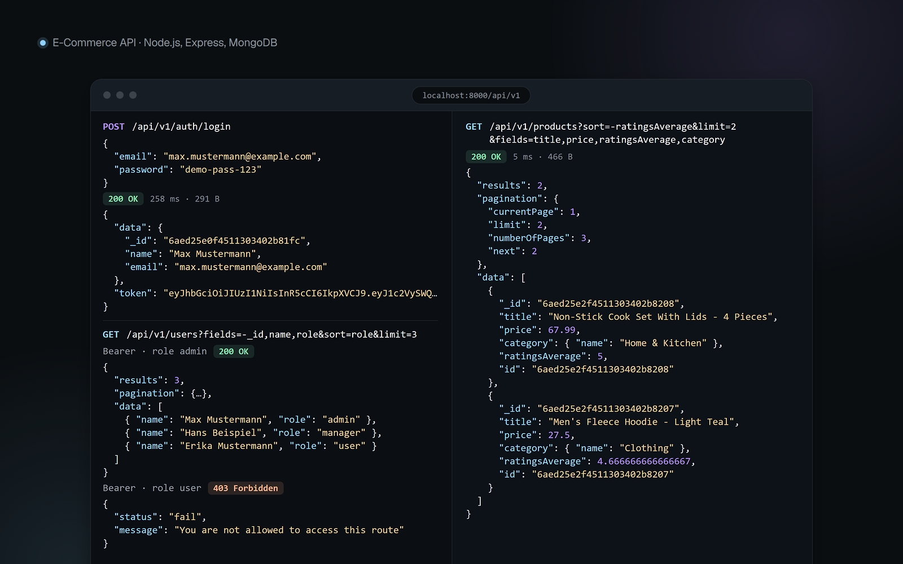

# Node.js E-Commerce API

A REST API for an online shop with role-based access, a product catalog, cart, orders and Stripe payments.



## Features

- JWT authentication with signup, login and password reset by email code
- Role-based access for users, managers and admins
- Products, categories, subcategories and brands with image upload and resizing
- Reviews with automatic product ratings, one review per user and product
- Wishlist, saved addresses, coupons and cart
- Cash orders and Stripe Checkout with a webhook
- Filtering, search, sorting, field selection and pagination on list routes
- Secure headers, rate limiting, input validation and secret fields kept out of every response
- Swagger UI and a Postman collection

## Tech stack

Node.js, Express 5, MongoDB, Mongoose, JWT, bcrypt, express-validator, Multer, Sharp, Stripe, Nodemailer, Helmet, Swagger UI

## Roles

| Action                                                      | Visitor | User | Manager | Admin |
| ----------------------------------------------------------- | :-----: | :--: | :-----: | :---: |
| Browse products, categories, brands and reviews             |   Yes   | Yes  |   Yes   |  Yes  |
| Manage own profile                                          |         | Yes  |   Yes   |  Yes  |
| Use wishlist, addresses and cart, place orders, write reviews |         | Yes  |         |       |
| View orders                                                 |         | Own  |   All   |  All  |
| Create and update catalog items and coupons                 |         |      |   Yes   |  Yes  |
| View users, mark orders as paid or delivered                |         |      |   Yes   |  Yes  |
| Delete any review                                           |         |      |   Yes   |  Yes  |
| Delete catalog items and coupons                            |         |      |         |  Yes  |
| Create, update and delete users                             |         |      |         |  Yes  |

## Run locally

You need Node.js 24 or newer and a MongoDB database (local, or a free Atlas cluster).

1. Install the dependencies:

   ```bash
   git clone https://github.com/Ziad-Alghawi/nodejs-ecommerce-api.git
   cd nodejs-ecommerce-api
   npm install
   ```

2. Create your environment file and set `DB_URI` in it:

   ```bash
   cp .env.example .env
   ```

3. Add the demo data and start the server:

   ```bash
   npm run seed
   npm run start:dev
   ```

Then open <http://localhost:8000/api-docs>.

### Demo accounts

`npm run seed` creates these accounts, plus demo categories, brands, products and the coupon `DEMO10`. All of them are fake. `npm run seed:destroy` removes only the demo data.

| Role    | Email                 | Password        |
| ------- | --------------------- | --------------- |
| Admin   | `admin@example.com`   | `demo-pass-123` |
| Manager | `manager@example.com` | `demo-pass-123` |
| User    | `user@example.com`    | `demo-pass-123` |

## Environment variables

| Variable                | Description                                                 |
| ----------------------- | ----------------------------------------------------------- |
| `PORT`                  | Server port, defaults to `8000`                             |
| `NODE_ENV`              | `development` or `production`                               |
| `BASE_URI`              | Base URL used in image links                                |
| `TRUST_PROXY`           | Number of proxies in front of the app, `0` when run locally |
| `DB_URI`                | MongoDB connection string                                   |
| `JWT_SECRET_KEY`        | Secret used to sign tokens                                  |
| `JWT_EXPIRES_TIME`      | Token lifetime, for example `90d`                           |
| `EMAIL_HOST`            | SMTP host, for password reset emails                        |
| `EMAIL_PORT`            | SMTP port (TLS, for example `465`)                          |
| `EMAIL_USER`            | SMTP user                                                   |
| `EMAIL_PASS`            | SMTP password                                               |
| `STRIPE_SECRET`         | Stripe test secret key, required at startup                 |
| `STRIPE_WEBHOOK_SECRET` | Stripe webhook signing secret                               |

## API docs

- Swagger UI: [`/api-docs`](http://localhost:8000/api-docs). Log in, click **Authorize** and paste the token.
- Postman: import [`postman/ecommerce-api.postman_collection.json`](postman/ecommerce-api.postman_collection.json).
- Health check: `GET /health`
- Base path: `/api/v1`

## Project structure

```text
config/        Database connection
docs/          OpenAPI spec and screenshot
middlewares/   Error handling, validation and image upload
models/        Mongoose schemas
postman/       Postman collection
routes/        Route definitions
services/      Business logic
uploads/       Uploaded images and demo placeholders
utils/         Validators, query features, email and seed data
server.js      App entry point
render.yaml    Render deployment
```

## License

ISC
